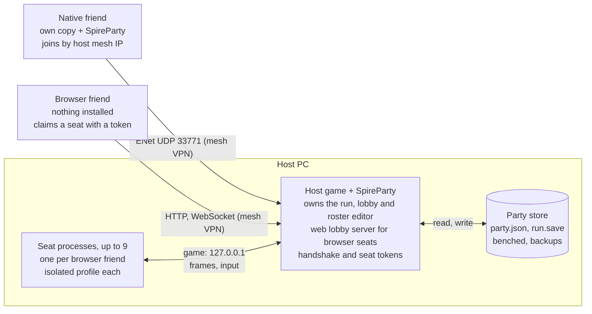

# SpireParty — STS2 Multiplayer Mod Design Document

Last updated: 2026-11-16 · Source of truth: the Claude Doc this was exported from.

## Overview and goals

SpireParty is one C# mod for Slay the Spire 2 that lets up to 10 friends play a single co-op run, each either from their own copy of the game or from a browser seat hosted on the host's PC, with the party roster changeable between combats.

The mod has three user-facing goals:

1. **Mixed party, all remote.** Friends join from outside the host's home either with their own copy (plus this mod) or from a browser with nothing installed. Everyone reaches the host through a mesh VPN (Tailscale or NordVPN Meshnet).
2. **Up to 10 players** in one run, up from the vanilla 4.
3. **Join and leave mid-run.** At a safe point the host saves, quits, edits the roster in-game and reloads. Players are identified by party-chosen seat IDs, never by Steam account.

Success criteria for v1:

- A 10-player run reaches the Act 3 boss with at least 2 browser seats and 2 remote native players.
- One player leaves and one new player joins during that run without corrupting the save.
- A native friend installs exactly one mod; a browser friend installs nothing.

## Scope and non-goals

v1 ships the smallest version of each goal that a group of friends can actually play; anything that only adds polish or reach is deferred.

| Area | In v1 | Deferred or excluded |
| --- | --- | --- |
| Networking | Direct connect (game's ENet transport) over the mesh VPN | Steam lobbies and invites for SpireParty runs; public-internet hosting; mixing Steam and direct-connect players in one run |
| Player count | Cap raised to 10; layouts fixed for 5 to 10 | Above 10 |
| Pacing and AFK | Optional turn timer; waiting-on list and nudge; AFK auto-pass; browser-seat handoff; vote to kick; rewind and bench | Another player playing an AFK native seat's cards; vote timer, unless the game's vote code allows it |
| Saves and progress | Party saves in SpireParty's own folder; profile saves and progress never touched | Steam Cloud sync of party saves |
| Game modes | Standard, every ascension level, custom, daily, Blitz and Dread | Daily leaderboard submission; achievements from party runs |
| Browser seats | Video streaming of a seat instance to a desktop browser, mouse and keyboard | Scene-sync renderer (CouchCoop style); phone touch UI; audio |
| Roster | Join, leave, bench and restore at safe points via save, quit, reload | Live join during combat or mid-event |
| Identity | Party-chosen seat IDs; one roster per run | Accounts, passwords, cross-run player profiles |
| Host platform | Windows and Linux hosts and clients, one build | macOS (code kept portable, untested) |
| Balance | Verify enemy scaling is sane at 10; one tunable multiplier | Full rebalance of multiplayer cards and events |

## Constraints and assumptions

The design is shaped by five fixed constraints; each one rules out a simpler alternative.

1. **One mod, nothing else.** A native friend installs a single `SpireParty` folder. No BaseLib or other library mods as separate installs: anything needed is compiled into SpireParty's own DLL. Browser friends install nothing.
2. **Everyone is remote, on a mesh VPN.** Every friend joins from outside the host's home through Tailscale or NordVPN Meshnet. Nothing is exposed to the public internet, so no port forwarding and no public HTTPS certificates are needed.
3. **Gameplay mod, exact version match.** Since game patch 0.99.1 the mod manifest has an `affects_gameplay` field; [when it is false the mod is not checked against the host's mod list](https://egw.news/gaming/news/33197/slay-the-spire-2-caps-hp-at-nearly-a-billion-crush-CCZa_ZVwO). SpireParty changes player count and save handling, so it must declare `affects_gameplay: true`, and every native player needs the identical version. It should also avoid registering new game content, because changes to the game's model database [alter a hash used in multiplayer validation](https://github.com/Alchyr/BaseLib-StS2/issues/172).
4. **Early Access churn.** The game is [frequently updated in ways that break mods](https://github.com/Alchyr/ModTemplate-StS2/wiki/). Networking, lobby and save code are the most fragile areas to patch, so every patch site is isolated behind a small adapter layer (see Risks).
5. **No monetization, no asset redistribution.** Mods [may accept donations but may not otherwise be monetized](https://github.com/tfoxy/sts2-couch-coop) under Mega Crit's content policy. Browser seats stream frames from the host's own installation; no game files leave the host. Keep the browser side private to the friend group.

Host and clients may run Windows or Linux; neither OS is privileged (see Cross-platform design). macOS is not tested in v1.

## System architecture

Everything runs on the host PC except native friends' own games; all of them meet in one game session that the host's game owns.



Native friends run the game themselves. Browser friends only see and steer a seat process, which joins the run like any other client over 127.0.0.1, so the game cannot tell the two kinds apart.

## Networking and transport

All players, local and remote, connect to the host over the game's own ENet/UDP transport, addressed by the host's mesh-VPN IP; Steam networking is not used for SpireParty runs.

The game already contains this transport. Existing LAN mods [reuse the vanilla ENet/UDP room creation and join flow](https://github.com/murongyueyu/sts2-lan-coop), and DirectConnectIP listens on [UDP 33771 by default](https://github.com/TasteSteak/sts2-DirectConnectIP-Mods/blob/master/README.md). SpireParty only needs to expose it in the menus and add its own handshake.

**Addresses.** The host listens on UDP 33771 on all interfaces. Remote friends connect to the host's Tailscale IP (100.x.y.z) or MagicDNS name, or its NordVPN Meshnet IP. Browser seats on the host connect to 127.0.0.1. Nobody forwards ports.

**Menu changes.** The multiplayer menu gets two entries:

- *SpireParty Host*: pick or create a party save, then open the lobby.
- *SpireParty Join*: enter host address and seat ID; remembers recent hosts.

**Handshake.** Before the game's own lobby join, the client sends a SpireParty hello message: mod version, game build ID, seat ID and seat token. The host refuses with a readable reason on any mismatch ("host runs SpireParty 0.4.1, you run 0.4.0"), instead of the game's generic validation failure.

**Disconnects.** In v1 a dropped player rejoins by connecting again with the same seat ID; the host keeps that seat reserved. Letting the host temporarily play for a disconnected player, as DirectConnectIP's [offline takeover](https://github.com/TasteSteak/sts2-DirectConnectIP-Mods/blob/master/README.md) does, is a stretch goal.

**To test early:** Tailscale's tunnel MTU is 1280 bytes, smaller than common UDP game packet sizes. Confirm large lobby and save-sync messages survive the tunnel, and lower the ENet MTU if the game exposes it.

## Identity and party roster

A player is a *seat* in a *party*, identified by a short name the party picks and a numeric player ID that SpireParty assigns; Steam accounts play no part, so any device can claim any seat.

In vanilla multiplayer the save keys each player by a numeric ID that comes from Steam. Direct-connect mods already show this ID can be replaced: DirectConnectIP lets players [customize the Player ID that serves as their unique identifier](https://github.com/TasteSteak/sts2-DirectConnectIP-Mods/blob/master/README.md). SpireParty takes that one step further and makes the host the only authority that hands IDs out.

**Party.** One party equals one run. The host creates it with a name ("thursday-crew"). Everything about the party, including its run save, lives in SpireParty's own folder and never in the game's profile folders (see Saves, progression and game modes).

**Seat fields** (stored in `party.json`):

| Field | Example | Notes |
| --- | --- | --- |
| Seat ID | `ravi` | Chosen by any party member at first join; unique in the party |
| Player ID | `7000003` | Assigned by host once, never reused in this party; this is what the save stores |
| Token | `amber-otter-41` | Shown once to the seat's owner; required to claim the seat again |
| Display name | Ravi | Shown in game UI |
| Kind | native or browser | Browser seats are launched by the host |
| State | active, benched, empty | Benched seats keep their run state aside (see Join and leave) |
| Character | Ironclad | Fixed once the seat joins the run |

**Claiming a seat.** The joining client sends seat ID and token in the handshake. The host answers with the seat's player ID, and the client adopts it as its local player ID before the game's lobby join runs. A new seat ID with no token creates a seat, only while the host has the lobby open for new players.

**Lost tokens.** The host can reset a seat's token from the roster screen.

## Turn timer and AFK protection

An optional per-turn timer (45 seconds by default when switched on) ends a slow player's turn for them, and a short ladder of AFK tools handles anyone who stays stuck, from automatic passing up to a party vote to kick.

**Design rule: no forged actions in v1.** Every timer and AFK effect is either a normal action taken by the stuck player's own game (pressing End Turn, skipping a reward) or a roster change through flows SpireParty already has. The host never submits actions on another player's behalf. That keeps the game's own action sync untouched, so these features cannot cause a desync.

**Turn timer.**

- Host setting per party: off (default), 30, 45, 60 or 90 seconds.
- Starts when a player can act, after enemy-turn animations finish; shown as a ring on the End Turn button, with a warning at 10 seconds.
- At zero, that player's own client presses End Turn. Cards already played stay played.
- The host can pause the timer for everyone, for example while someone steps away briefly.

**AFK ladder.** Each step is cheap because it reuses something already in the design.

| Step | Trigger | What happens | Effort |
| --- | --- | --- | --- |
| 1. Waiting-on list and nudge | Always on | Shows who has not ended their turn or voted; any player can nudge, which flashes and sounds on that player's screen | Low |
| 2. Turn timer | Timer reaches zero | Player's own client ends the turn | Low |
| 3. AFK auto-pass | 2 timed-out turns in a row | Seat marked AFK: its turns end at once instead of after 45 seconds, and its rewards are skipped; any input from the player clears the mark | Low |
| 4. Browser-seat handoff | Host action | Host resets a browser seat's token so another friend can take over that seat immediately; the seat process keeps running, so nothing is lost | Low |
| 5. Vote to kick | Majority of other players, or host alone | Seat stays in AFK auto-pass until the next safe point, then is benched automatically through the normal roster flow | Medium |
| 6. Rewind and bench | Host action, for a frozen or disconnected game | Host reloads the last autosave, benches the stuck seat, and the party replays the current room without them | Medium |

**What steps 2 and 3 cannot fix.** They rely on the stuck player's game still running. If that game has frozen or dropped off the network, step 6 is the fallback: the party loses progress in the current room but is never stuck. A heartbeat in the SpireParty handshake channel tells the host which case it is.

**Deferred.** Letting the host or another native player play an AFK native seat's cards needs the host to submit that player's actions. DirectConnectIP shows it can be done, through its [offline player takeover](https://github.com/TasteSteak/sts2-DirectConnectIP-Mods/blob/master/README.md), but it is the one AFK feature that touches action sync, so it waits until after v1.

**Shared choices.** Map votes and other party-wide choices also wait for everyone. In v1, steps 1, 3 and 5 cover them; a vote timer that settles a vote without the missing players is added only if the game's vote code allows it (see open questions).

## Saves, progression and game modes

Party runs read and write only inside SpireParty's own folder, never the profile folders that hold your normal single-player and co-op saves, and the party lobby offers every mode the installed game version has.

**Where the game keeps saves today.** On Windows, run saves sit in a profile folder keyed by Steam account, and the game already keeps [modded play in a separate `modded` subfolder](https://sts2.gg/guides/how-to-install-mods). The single-player run is `current_run.save` and the co-op run is [`current_run_mp.save`](https://www.nexusmods.com/slaythespire2/mods/225).

| Data | Windows path | Touched by party runs |
| --- | --- | --- |
| Vanilla profile | `%APPDATA%\SlayTheSpire2\steam\<SteamID>\profile1\` | Never |
| Modded profile (your normal play with mods on) | `%APPDATA%\SlayTheSpire2\steam\<SteamID>\modded\profile1\` | Never; writes are blocked during a party run |
| SpireParty data | `%APPDATA%\SlayTheSpire2\mods\SpireParty\` | Only here |

Keeping mod data under `SlayTheSpire2\mods\<mod>\`, outside any Steam ID folder, has precedent: [BetterSaves stores its data there](https://sts2.gg/mods/mod-372).

**Redirect, not swap.** While a party run is active, SpireParty patches the game's save-path lookup so the co-op run save resolves to the party's own `run.save`. Leaving the run removes the redirect. The normal `current_run_mp.save` is never read, moved or overwritten, so a normal co-op run and any number of party runs can be in progress at the same time. This replaces the swap-into-place approach Multiplayer Save Slots uses.

```
mods/SpireParty/parties/thursday-crew/
  party.json   roster, seats, mode and unlock settings
  run.save     the run, written by the game's own serializer
  benched/     state of benched seats
  backups/     copy taken before every roster edit
  history/     records of this party's finished runs
```

**Not tied to Steam.** The party belongs to whoever holds the folder: copy it to a friend's PC and they can host the same run. Because it sits outside the game's profile folders, do not count on Steam Cloud to sync it; SpireParty's own backups are the safety net.

**Progression stays out too.** Ending a run writes more than the run save: run history, statistics, ascension progress and unlocks. During a party run, SpireParty sends run history to the party's `history/` folder and skips every write to the profile's progress, achievements and daily leaderboard. Party runs never advance or alter your normal progress.

**Unlocks for party runs.** Some modes are gated by profile progress: [Blitz opens after one finished Ascension run, Dread after Ascension 10 on every character](https://apollotrail.com/blog/slay-the-spire-2-blitz-dread-modes-explained). Party runs do not touch the profile, so each party picks an unlock setting when it is created:

| Setting | What the lobby offers |
| --- | --- |
| Everything unlocked (default) | All characters, every ascension level, every mode in this game version |
| Mirror host | Whatever the host's modded profile has unlocked, read but never written |

The setting must be identical on every client, so the host sends it in the handshake.

**Modes.** The party lobby uses the game's own mode and ascension pickers; SpireParty only stores the choice in `party.json`.

| Mode | In party runs | Notes |
| --- | --- | --- |
| Standard, Ascension 0 to 10 | Yes | Ascension picked in the lobby |
| Custom (modifiers) | Yes | Modifiers stored with the party |
| Daily | Yes, local only | Same daily seed; no leaderboard submission |
| Blitz, with its own Ascension 1 to 5 | Yes, beta branch | No map, so the roster safe point is after an encounter's rewards |
| Dread | Yes, beta branch | New joiners get the Ascender's Banes the party has collected so far |

Mega Crit says [Blitz and Dread work in both single-player and multiplayer](https://apollotrail.com/blog/slay-the-spire-2-blitz-dread-modes-explained), but both are on the [public-beta branch only (v0.113.0)](https://insider-gaming.com/slay-the-spire-2-new-character-modes/) for now. SpireParty ships one build per branch in the same download and loads the one that matches, as [CouchCoop does](https://github.com/tfoxy/sts2-couch-coop/releases/tag/v0.4.1). Every player must be on the same branch.

## Ten-player support

Raising the cap to 10 is a one-line change; the real work is every screen and formula that assumed at most 4 players.

RemoveMultiplayerPlayerLimit is the reference. It supports [8 players by default and up to 16, with rendering errors and UI issues possible above 8](https://www.nexusmods.com/slaythespire2/mods/21), and it already reworks the [campfire into rows, the shop into a grid and the treasure room relics into two rows](https://gitee.com/ShayLee141/sts2-RMP-Mods). SpireParty vendors that logic and targets exactly 10.

| Screen or system | Work needed | Source |
| --- | --- | --- |
| Lobby and run start | Raise cap to 10 | Vendored from RMP |
| Campfire, shop, treasure | Row and grid layouts | Vendored from RMP |
| Combat | Fit 10 player characters and their health bars; two ranks or scaled sprites | New; RMP only promises 8 cleanly |
| Player info panels | Compact list or two columns for 10 | New |
| Map voting | Readable markers for 10 voters | New, verify first |
| Ally-targeting cards and potions | Target picker usable with 10 allies | New, verify first |
| End-of-run screen | Fit 10 summaries | New, verify first |

**Balance.** Enemy health in vanilla [scales with party size](https://slay-the-spire-2.pages.dev/guides/multiplayer-faq/). Before changing anything, read the formula in the decompiled code and chart it for 1 to 10 players. Ship one host setting, an enemy health multiplier, rather than a rebalance.

**Pacing.** Turns are simultaneous, so a 10-player turn ends when the slowest player ends theirs. The optional turn timer and AFK tools (see Turn timer and AFK protection) keep one slow or absent player from stalling the other nine.

## Host seats and web client

Each browser player gets a dedicated game process on the host that captures its own rendered frames and receives that player's input directly, so the host never captures windows or moves the real mouse.

CouchCoop proves the process model: [the host launches a separate copy of the game for each browser player and connects it to the session](https://github.com/tfoxy/sts2-couch-coop), measured at [roughly 20% more CPU and 50% more RAM per extra player](https://github.com/tfoxy/sts2-couch-coop). SpireParty differs in what the browser receives: video frames instead of a reconstructed scene, which avoids writing a second renderer.

**Seat process.** The host mod launches the game again with a seat argument (`--spireparty-seat=ravi`). In seat mode, SpireParty:

- points the game at an isolated profile folder for that seat, so seats never share settings or saves;
- skips menus and connects to 127.0.0.1 as that seat;
- renders at 1280x720, capped at 30 fps, with audio muted;
- runs a small capture loop that reads the game's own viewport image and hands frames to the encoder;
- turns browser input into the game's own input events in-process, so 9 seats never fight over one OS cursor.

**Streaming, in two steps.**

1. *MVP:* JPEG frames over a WebSocket, encoded with Godot's built-in JPEG encoder so no native libraries are needed, sent only when the frame changed, plus input messages back. Simple to build and debug; expect a few megabytes per second per seat.
2. *Target:* WebRTC video (VP8 or H.264) with a data channel for input, using a managed C# WebRTC library bundled in the mod folder. Roughly 2 to 3 Mbit/s per seat; needed if the host's upload cannot carry the MVP for 9 seats.

**Web lobby.** The host mod embeds a small HTTP and WebSocket server that runs on plain sockets, bound only to the mesh-VPN interface. It avoids Windows' HttpListener, which needs admin rights or a URL reservation to listen on a non-localhost address. It serves one page: party name, list of browser seats, a token box to claim a seat, then the seat view in a canvas that scales to the browser window. Desktop browsers with mouse and keyboard are the target; phones are out of scope.

**To verify early:** how a second game process behaves with Steam on the same account (CouchCoop shows it can be done), and whether reading the viewport every frame costs too much with 9 seats running.

## Cross-platform design

Windows and Linux are equal hosts and clients from v1: the same SpireParty download hosts, joins and runs browser seats on either OS, and all OS-specific code sits in one small platform layer.

Most of SpireParty is OS-neutral already. The mod is managed .NET code loaded by the game, frames are read from the game's own viewport rather than captured from OS windows, and input is injected as game events rather than OS mouse events. What remains is listed below.

| Concern | Windows | Linux | How SpireParty handles it |
| --- | --- | --- | --- |
| Game data folder (build references) | `data_sts2_windows_x86_64` | `data_sts2_linuxbsd_x86_64` | [Both paths are known to the community template](https://www.nuget.org/packages/S2SModTemplate.Templates); one DLL ships for both |
| SpireParty data folder | `%APPDATA%\SlayTheSpire2\mods\SpireParty\` | [`~/.config/SlayTheSpire2/mods/...` by default](https://sts2.gg/mods/mod-372) | Always resolved through Godot's `user://` path, never hard-coded |
| Launching seat processes | Game `.exe` | Game Linux binary | Path taken from the running game process |
| Seat profile isolation | Separate user folder per seat | Separate user folder per seat | CouchCoop [already does this on both OSes](https://github.com/tfoxy/sts2-couch-coop) |
| Video encoder (WebRTC step only; the MVP uses Godot's JPEG encoder) | win-x64 library | linux-x64 library | Both shipped in `native/`, loaded by runtime ID |
| Firewall | Windows Defender Firewall rule | nftables or ufw rule | Documented for both; SpireParty never changes firewall settings itself |
| File names | Case-insensitive | Case-sensitive | All file names lower-case; paths built with path APIs, no drive letters or backslashes |

**Rule for the code.** No OS checks outside the platform layer. The layer exposes four things: data folder, seat-process launcher, encoder loader and firewall help text.

**Test matrix.** Every milestone gate is passed on Windows first, then twice across OSes: Windows hosting with a Linux client, then Linux hosting with a Windows client. M0 and M1 batch their Linux checks into one Fedora checkpoint (see Milestones). macOS code stays portable but is untested in v1.

## Join and leave mid-run

Roster changes happen only at a safe point between encounters, through save, quit, edit, reload, and every edit goes through the game's own save code rather than hand-editing the file.

Vanilla forbids this outright: [a replacement player cannot be added midway, and the party must resume with the original roster](https://sts2db.com/questions/multiplayer/). The game also checks the roster when a saved run is loaded; [Multiplayer Save Slots warns when lobby participants do not match the campaign roster](https://github.com/jadistanbelly/sts2-multiplayer-save-slots). SpireParty patches that check to accept the roster stored in `party.json`.

**Host flow.**

1. At a safe point (the map screen; in Blitz, after an encounter's rewards are taken), the host picks *Edit roster* from the pause menu. The game saves and returns to the main menu.
2. SpireParty opens the roster editor for that party and copies the save to a timestamped backup first.
3. The host applies any of: bench a seat, restore a benched seat, add a new seat, remove a seat permanently, reset a token.
4. SpireParty loads the save into the game's run-state objects, applies the changes using the game's own player creation code, and writes it back with the game's own serializer.
5. The host reopens the lobby. Seats rejoin by seat ID; the run continues from where it was saved.

**Bench and restore (leave).** Benching moves that player's serialized state into `benched/<seat>.json` and removes them from the run. Restoring puts it back unchanged, so a friend who skips a session returns with the same deck, relics, HP and gold. Removing deletes it.

**Add (join).** The new seat picks a character and starts with that character's starter deck and relic, plus one simple catch-up rule: its gold and max HP are raised to match the party member with the least of each. Both are switches in `party.json` (`catchUp.gold`, `catchUp.maxHp`), and `catchUp.cardRewards` (default 0) can grant extra card reward picks if new players turn out too weak.

In Dread, a new player also starts with the Ascender's Banes the party has collected so far: one, plus one per act already finished.

**Fail closed.** Before benching or removing, SpireParty scans the run state for any other reference to that player's ID. If it finds one it does not know how to clean up, it refuses the edit and names it, instead of writing a save that may not load. Backups make every edit reversible.

## Single-mod packaging and code reuse

SpireParty ships as one folder in the game's `mods` directory with no declared mod dependencies; borrowed code is copied in and compiled into SpireParty's own DLL, with each source's license kept beside it.

"One mod" means one folder and one manifest, not one file. Third-party .NET libraries and native encoder libraries sit inside that folder, so installing is still a single Workshop subscription or a single zip extract.

```
mods/SpireParty/
  SpireParty.json          manifest: affects_gameplay true, no dependencies
  SpireParty.dll           all SpireParty code, including vendored mod code
  lib/                     third-party .NET libraries (HTTP server, WebRTC)
  native/                  encoder libraries per platform (WebRTC step only)
  web/                     lobby page and seat viewer
  LICENSE
  THIRD_PARTY_NOTICES.md   one entry per vendored source
```

**What to borrow, and on what terms.** Licenses below are as each project states them; recheck at the moment of copying, since they can change.

| Source | What to take | License | Obligation |
| --- | --- | --- | --- |
| [RemoveMultiplayerPlayerLimit](https://www.nexusmods.com/slaythespire2/mods/21) | Player cap, campfire, shop and treasure layouts | [CC0 per its README](https://gh.r-mj.com/zuiter/sts2-RMP-Mods); a mirror lists MIT | None required; credit anyway |
| [CouchCoop](https://github.com/tfoxy/sts2-couch-coop) | Seat process launch, isolated seat profiles, seat Steam handling | [Apache 2.0](https://github.com/tfoxy/sts2-couch-coop) | Keep license and NOTICE; mark changed files |
| [DirectConnectIP](https://github.com/TasteSteak/sts2-DirectConnectIP-Mods) | ENet host and join, custom player ID, reconnect | [CC BY-NC 4.0](https://github.com/TasteSteak/sts2-DirectConnectIP-Mods/blob/master/README.md) | Attribution; whole mod stays non-commercial |
| [sts2-lan-coop](https://github.com/murongyueyu/sts2-lan-coop) | ENet lobby, guest seat takeover, named saves | Not confirmed | Read only until a license is confirmed |
| [Multiplayer Save Slots](https://github.com/jadistanbelly/sts2-multiplayer-save-slots) | Roster-check handling (its save swap is not used) | Not confirmed | Read only until a license is confirmed |

Code from projects without a confirmed license is studied, not copied; SpireParty reimplements that behavior itself. BaseLib and similar library mods are not used, so friends never install them.

**Distribution.** A Steam Workshop item for native friends, plus a GitHub release zip with the same folder. The Workshop item lists no required items.

## Security

The mesh VPN is the outer wall and seat tokens are the inner one: only party members can reach the host, and only a token holder can play a given seat.

CouchCoop warns that on its LAN setup [anyone who can reach the join address can open the client and send game controls](https://github.com/tfoxy/sts2-couch-coop). SpireParty closes that gap in three layers.

1. **Reachability.** The game port (UDP 33771) and the web server listen only on the mesh-VPN interface, and SpireParty drops traffic from source addresses outside the mesh range. An OS firewall rule scoped to that adapter backs this up (see Cross-platform design). In Tailscale, an access rule lets friends reach only those two ports on the host, nothing else on it; NordVPN Meshnet's per-device permissions should be set the same way.
2. **Seat tokens.** Every claim, native or browser, needs the seat's token. Tokens are random, stored hashed in `party.json`, and failed attempts are rate-limited per address.
3. **Narrow surface.** The web server serves only the lobby page, frames and input; it never reads arbitrary files. Browser input becomes game input events inside the seat process, never OS-level mouse or keyboard input.

**Transport encryption.** Mesh traffic is already encrypted end to end, so plain HTTP inside the mesh is acceptable for v1. If a browser feature needs a secure origin, Tailscale's built-in HTTPS serving for the host's tailnet name is the fallback.

**Trust model.** Party members are trusted friends. A seat holder can do anything the game lets a player do, and the host can bench or remove any seat.

## Defaults and configuration

Every choice a group might want differently is a setting with a simple default: party settings live in the party's `party.json`, machine settings in SpireParty's `config.json`, both plain JSON a host can edit by hand.

| Setting | File | Default | Allowed |
| --- | --- | --- | --- |
| Max players | party.json | 10 | 2 to 10 |
| Unlocks | party.json | Everything unlocked | Everything, mirror host |
| Enemy health multiplier | party.json | 1.0 | 0.5 to 3.0 |
| Turn timer | party.json | Off | Off, 30, 45, 60, 90 s |
| AFK strikes before auto-pass | party.json | 2 | 1 to 5 |
| Vote to kick | party.json | Majority of the other players | Majority, unanimous, host only |
| Catch-up gold, max HP | party.json | Match party's lowest | Match lowest, starter only |
| Catch-up card rewards | party.json | 0 | 0 to 10 |
| Game port | config.json | UDP 33771 | Any free port |
| Web port | config.json | TCP 8771 | Any free port |
| Listen address | config.json | Auto: the Tailscale or Meshnet interface | Any local address |
| Browser seats | config.json | On | On, off |
| Seat video | config.json | 1280x720, JPEG quality 70, at most 15 frames per second | Any |
| Backups kept per party | config.json | 20 | 1 to 100 |

**Flexibility rules.**

- A missing or empty settings file works: every key has a default, and unknown keys are ignored.
- Each feature (browser seats, timer, AFK tools, catch-up) can be switched off without affecting the others.
- Each game patch site sits behind its own adapter, so a game update breaks one adapter, not the mod.
- Transport, streaming and HTTP code sit behind small interfaces, so WebRTC or a different server can replace the MVP pieces later.

## Risks and open questions

The biggest risk is not any single feature but game patches breaking networking and save patches every few weeks; the biggest unknown is what in the save refers to a player's ID.

| Risk | Likelihood | Mitigation |
| --- | --- | --- |
| A game patch breaks a patch site | High | One adapter class per patch site; a startup self-check that names the broken patch and disables SpireParty cleanly instead of crashing; test on the public beta branch before each release |
| Stable and beta branches diverge (Blitz and Dread are beta-only) | High | One build per branch in the same download; handshake refuses mixed branches |
| A party run leaks a write into the normal profile | Medium | Block profile writes during party runs; test by hashing the profile folders before and after a full party run |
| Bench or remove leaves dangling player references | Medium | Fail closed (see Join and leave); prototype this first |
| Desync ("state divergence") with 10 players or after a roster edit | Medium | Roster edits only at safe points; identical mod version enforced by handshake; long soak tests at 10 |
| 9 rendering seats overload the host | Medium | Measure in milestone 4; lower seat fps and resolution; cap browser seats |
| Host upload too small for JPEG streaming | Medium | Move to WebRTC video |
| Mega Crit ships official rejoin or larger parties | Low | Welcome it; retire the overlapping part |

**Open questions.** Milestone 0 answers each one by reading the decompiled game. Until then, the design assumes the simplest answer and names the fallback if it turns out wrong.

**M0 status (v0.113.1):** answered in `docs/findings.md` → Open questions answered.
- The assumption holds for 3, 4, 6, 8, 11, 12, 13, 14 and 15. For 14, the vanilla rejoin flow is the first answer to a drop.
- It holds partly for 1, 2 and 9.
- It fails for 5 and 10; the fallbacks apply. For 5, the lobby wire format must also be widened.
- Question 7 is still open, and its fallback changes: the MTU cannot be set from Godot's API, so the fallback is a custom transport. It will be tested at the Fedora checkpoint.

| Question | Simplest assumption | Fallback if wrong |
| --- | --- | --- |
| Where does the client's player ID come from, and where is it validated? | One ID provider that can be patched | Patch the lobby join message instead |
| Which run-state objects reference a player ID? | Only that player's own state plus transient votes | Fail closed; add a cleanup per reference found |
| Can one player's state be saved and restored on its own? | Yes, it is a self-contained object | Copy the player's subtree of the save file |
| Enemy health formula beyond 4 players? | Per-player formula that extends naturally | Clamp at the 4-player value, then apply the multiplier |
| Code that assumes at most 4 players? | A few constants and layout arrays | Vendored RMP patches, then fix screens one by one |
| Does a seat process need Steam? | No, as CouchCoop's seats show | Patch out Steam start-up in seat mode |
| ENet over a 1280-byte tunnel? | Works with defaults | Lower the MTU, or split large messages |
| Where are save paths resolved? | One path helper | Patch each place that opens the co-op save |
| What is written when a run ends? | A handful of save calls | Patch each one; prove with a folder-hash test |
| Whose unlocks decide co-op card pools? | The host's | Handshake already forces one unlock setting on everyone |
| Where can Blitz pause between encounters? | After an encounter's rewards | Roster edits only between acts in Blitz |
| Can a client press its own End Turn from code? | Yes, via the method the button calls | Simulate the button press |
| When does co-op autosave? | At room entry; reload restarts the room | Rewind to the last safe-point save |
| What happens on a mid-combat disconnect? | Party can save and quit | Host quits to menu, then rewind and bench |
| Can a vote settle without a missing player? | No | Nudge, auto-pass and kick cover it |

## Milestones

Build in six milestones, starting with a research spike on the riskiest unknown, the save's player references, and move on only when a group of friends can play through that milestone's gate.

**Windows first.** Each gate has two parts. The *Windows gate* is passed on the Windows VM alone, using two or more game processes on that machine as the players (host plus clients over 127.0.0.1). The *cross-OS gate* is passed twice: Windows hosting with a Linux client, then Linux hosting with a Windows client.

- M0 and M1 need only their Windows gates to move on. Their Linux work (Linux load check, ENet over the 1280-byte Tailscale tunnel, and the M1 cross-OS gate) is batched into one **Fedora checkpoint**, run once M1 passes its Windows gate.
- M2 does not start until the Fedora checkpoint has passed.
- From M2 on, every milestone passes both parts of its gate before the next one starts.
- If the VM cannot run two game processes as separate players, the M1 Windows gate cannot be met on one machine; the Fedora checkpoint then moves forward to the M1 gate itself.

| Milestone | Work | Gate to move on |
| --- | --- | --- |
| M0 · Research spike | Decompile `sts2.dll`; answer the open questions; prototype bench and remove on a copied save | Windows: each open question answered or worked around. Linux items deferred to the Fedora checkpoint |
| M1 · Direct connect and seat IDs | ENet host and join menus, handshake, tokens; seat IDs replace Steam IDs in saves | Windows: Act 1 with two game processes on the VM over 127.0.0.1 |
| Fedora checkpoint | Linux load check; deploy script on Linux; ENet over Tailscale; any M0 prototype that needed two machines | Act 1 over Tailscale with each OS as host |
| M2 · Party saves and roster editor | Per-party saves, backups, bench, restore, add; roster check patched; fail-closed scan | Bench, restore and add survive a full act |
| M3 · Ten players | Cap, layouts, turn timer, AFK tools; enemy health formula charted; multiplier | A 10-player act with no desync, combat readable |
| M4 · Browser seats | Seat processes, JPEG stream, lobby page; measure host CPU, GPU and upload with 9 seats | 3 browser seats play an act beside native friends |
| M5 · Release | WebRTC if upload demands it; startup self-check; Workshop item and zip; third-party notices | All v1 success criteria met |

M3 and M4 do not depend on each other and can run in parallel once M2's gate is passed.
