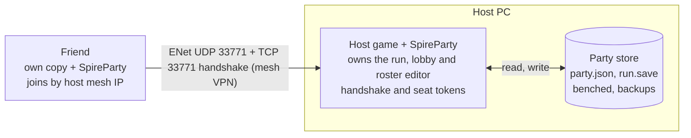

# SpireParty — STS2 Multiplayer Mod Design Document

Last updated: 2026-11-19 · Originally exported from a Claude Doc; this file is now the source of truth.

**Browser seats removed from scope (user, 2026-11-19).** Every player runs their own copy of the game. Browser seats (seat processes on the host streamed to a browser) are deferred past the first full release; see "Browser seats (deferred)" below. Releases are tagged `v0.x.y`.

## Overview and goals

SpireParty is one C# mod for Slay the Spire 2 that lets up to 8 friends play a single co-op run, each from their own copy of the game, with the party roster changeable between combats.

The mod has three user-facing goals:

1. **All remote.** Friends join from outside the host's home with their own copy plus this mod. Everyone reaches the host through a mesh VPN (Tailscale or NordVPN Meshnet).
2. **Up to 8 players** in one run, up from the vanilla 4 (lowered from 10 on 2026-11-18 by the user: 8 slots fit in 3 bits, one more than the game's 2-bit slot field, and 8 game processes fit on one PC for testing).
3. **Join and leave mid-run.** At a safe point the host saves, quits, edits the roster in-game and reloads. Players are identified by party-chosen seat IDs, never by Steam account.

Success criteria for v1:

- An 8-player run reaches the Act 3 boss with at least 2 remote players.
- One player leaves and one new player joins during that run without corrupting the save.
- A friend installs exactly one mod.

## Scope and non-goals

v1 ships the smallest version of each goal that a group of friends can actually play; anything that only adds polish or reach is deferred.

| Area | In v1 | Deferred or excluded |
| --- | --- | --- |
| Networking | Direct connect (game's ENet transport) over the mesh VPN | Steam lobbies and invites for SpireParty runs; public-internet hosting; mixing Steam and direct-connect players in one run |
| Player count | Cap raised to 8; layouts fixed for 5 to 8 | Above 8 |
| Pacing and AFK | In combat: optional turn timer and AFK auto-pass. Anywhere: the host benches a stuck player through the roster editor | Waiting-on list and nudge (the game already shows who has not ended their turn); vote to kick; AFK handling outside combat (events, shops, votes, rewards); another player playing an AFK native seat's cards; vote timer |
| Saves and progress | Party saves in SpireParty's own folder; profile saves and progress never touched | Steam Cloud sync of party saves |
| Game modes | Standard, every ascension level, custom, daily, Blitz and Dread | Daily leaderboard submission; achievements from party runs |
| Browser seats | None: every player runs the game | Video streaming of a seat instance to a browser (deferred 2026-11-19); scene-sync renderer; phone UI |
| Roster | Join, leave, bench and restore at safe points via save, quit, reload | Live join during combat or mid-event |
| Identity | Party-chosen seat IDs; one roster per run | Accounts, passwords, cross-run player profiles |
| Chat | Text chat for the party (T), shown for 10 seconds, memory only | Saved chat logs; voice; private messages |
| Host platform | Windows and Linux hosts and clients, one build | macOS (code kept portable, untested) |
| Balance | Verify enemy scaling is sane at 8; one tunable multiplier | Full rebalance of multiplayer cards and events |

## Constraints and assumptions

The design is shaped by five fixed constraints; each one rules out a simpler alternative.

1. **One mod, nothing else.** A friend installs a single `SpireParty` folder. No BaseLib or other library mods as separate installs: anything needed is compiled into SpireParty's own DLL.
2. **Everyone is remote, on a mesh VPN.** Every friend joins from outside the host's home through Tailscale or NordVPN Meshnet. Nothing is exposed to the public internet, so no port forwarding and no public HTTPS certificates are needed.
3. **Gameplay mod, exact version match.** Since game patch 0.99.1 the mod manifest has an `affects_gameplay` field; [when it is false the mod is not checked against the host's mod list](https://egw.news/gaming/news/33197/slay-the-spire-2-caps-hp-at-nearly-a-billion-crush-CCZa_ZVwO). SpireParty changes player count and save handling, so it must declare `affects_gameplay: true`, and every native player needs the identical version. It should also avoid registering new game content, because changes to the game's model database [alter a hash used in multiplayer validation](https://github.com/Alchyr/BaseLib-StS2/issues/172).
4. **Early Access churn.** The game is [frequently updated in ways that break mods](https://github.com/Alchyr/ModTemplate-StS2/wiki/). Networking, lobby and save code are the most fragile areas to patch, so every patch site is isolated behind a small adapter layer (see Risks).
5. **No monetization, no asset redistribution.** Mods [may accept donations but may not otherwise be monetized](https://github.com/tfoxy/sts2-couch-coop) under Mega Crit's content policy. SpireParty ships no game files.

Host and clients may run Windows or Linux; neither OS is privileged (see Cross-platform design). macOS is not tested in v1.

## System architecture

Every friend runs their own game; all of them meet in one game session that the host's game owns.



## Networking and transport

All players, local and remote, connect to the host over the game's own ENet/UDP transport, addressed by the host's mesh-VPN IP; Steam networking is not used for SpireParty runs.

The game already contains this transport. Existing LAN mods [reuse the vanilla ENet/UDP room creation and join flow](https://github.com/murongyueyu/sts2-lan-coop), and DirectConnectIP listens on [UDP 33771 by default](https://github.com/TasteSteak/sts2-DirectConnectIP-Mods/blob/master/README.md). SpireParty only needs to expose it in the menus and add its own handshake.

**Addresses.** The host listens on UDP 33771 on all interfaces. Remote friends connect to the host's Tailscale IP (100.x.y.z) or MagicDNS name, or its NordVPN Meshnet IP. Nobody forwards ports.

**Menu changes.** The multiplayer menu gets two entries:

- *SpireParty Host*: pick or create a party save, then open the lobby.
- *SpireParty Join*: enter host address and seat ID; remembers recent hosts.

**Handshake.** Before the game's own lobby join, the client sends a SpireParty hello message: mod version, game build ID, seat ID and seat token. The host refuses with a readable reason on any mismatch ("host runs SpireParty 0.4.1, you run 0.4.0"), instead of the game's generic validation failure.

**Disconnects.** In v1 a dropped player rejoins by connecting again with the same seat ID; the host keeps that seat reserved. Letting the host temporarily play for a disconnected player, as DirectConnectIP's [offline takeover](https://github.com/TasteSteak/sts2-DirectConnectIP-Mods/blob/master/README.md) does, is a stretch goal.

**To test early:** Tailscale's tunnel MTU is 1280 bytes, smaller than common UDP game packet sizes. Confirm large lobby and save-sync messages survive the tunnel, and lower the ENet MTU if the game exposes it.

## Identity and party roster

A player is a *seat* in a *party*, identified by a short name the party picks and a numeric player ID that SpireParty assigns; Steam accounts play no part, so any device can claim any seat.

In vanilla multiplayer the save keys each player by a numeric ID that comes from Steam. Direct-connect mods already show this ID can be replaced: DirectConnectIP lets players [customize the Player ID that serves as their unique identifier](https://github.com/TasteSteak/sts2-DirectConnectIP-Mods/blob/master/README.md). SpireParty takes that one step further and makes the host the only authority that hands IDs out.

**Party.** One party equals one run. The host creates it with a name ("thursday-crew"). Everything about the party, including its run save, lives in SpireParty's own folder and never in the game's profile folders (see Saves, progression and game modes).

**Seat fields** (stored in `party.json`):

| Field | Example | Notes |
| --- | --- | --- |
| Seat ID | `ravi` | Chosen by any party member at first join; unique in the party |
| Player ID | `7000003` | Assigned by host once, never reused in this party; this is what the save stores |
| Token | `amber-otter-41` | Shown once to the seat's owner; required to claim the seat again |
| Display name | Ravi | Shown in game UI instead of player IDs; set by the player when joining, or renamed by the host |
| Kind | native | Always native; the `browser` value is kept in the file format for the deferred browser seats |
| State | active, benched, empty | Benched seats keep their run state aside (see Join and leave) |
| Character | Ironclad | Fixed once the seat joins the run |

**Claiming a seat.** The joining client sends seat ID and token in the handshake. The host answers with the seat's player ID, and the client adopts it as its local player ID before the game's lobby join runs. A new seat ID with no token creates a seat, only while the host has the lobby open for new players.

**Lost tokens.** The host can reset a seat's token from the roster screen. That makes the seat open: the next player to join with its seat ID gets a new token (see Join and leave → Open seats).

## Turn timer and AFK protection

An optional per-turn timer in combat (45 seconds by default when switched on) ends a slow player's turn for them, and a seat that keeps timing out passes its turns automatically; anywhere else, the host benches a stuck player through the roster editor.

AFK handling is deliberately simple (decided 2026-11-18 by the user): an absent player is only costly mid-combat, where everyone else waits on every turn. Outside combat the party notices who is missing and the host benches them.

**Design rule: no forged actions in v1.** Every timer and AFK effect is either a normal action taken by the stuck player's own game (pressing End Turn, skipping a reward) or a roster change through flows SpireParty already has. The host never submits actions on another player's behalf. That keeps the game's own action sync untouched, so these features cannot cause a desync.

**Turn timer.**

- Host setting per party: off (default), 30, 45, 60 or 90 seconds.
- Starts when a player can act, after enemy-turn animations finish; shown as a ring on the End Turn button, with a warning at 10 seconds.
- At zero, that player's own client presses End Turn. Cards already played stay played.
- If a mandatory choice is open at zero (a card's or relic's selection screen), the timer waits for the player to make it and ends the turn right after.
- The host can pause the timer for everyone, for example while someone steps away briefly.

**AFK tools.** Each step is cheap because it reuses something already in the design.

| Step | Trigger | What happens | Effort |
| --- | --- | --- | --- |
| 1. Turn timer | Timer reaches zero | Player's own client ends the turn | Low |
| 2. AFK auto-pass (combat only) | 2 timed-out turns in a row (`afkStrikes`) | Seat marked AFK: its turns end at once instead of after the timer; any input from the player clears the mark | Low |
| 3. Bench | Host action, any time | **Edit roster** in the pause menu: Save and Quit, bench the seat, Continue. The party replays the current room without them. Also the answer to a frozen or disconnected game | Done in M2 |

**Outside combat.** Map votes, shared events, treasure, rest sites and rewards wait for every player, with no timeout in the game. SpireParty adds nothing there: the party sees who is missing and the host uses step 3.

**Deferred.** A waiting-on list, nudge, vote to kick, AFK seats answering votes or skipping rewards, and a vote timer. Letting the host or another native player play an AFK native seat's cards needs the host to submit that player's actions. DirectConnectIP shows it can be done, through its [offline player takeover](https://github.com/TasteSteak/sts2-DirectConnectIP-Mods/blob/master/README.md), but it touches action sync, so it waits until after v1.

## Party chat

Any player can send a short text message to the whole party during a SpireParty session (lobby, map, combat), through SpireParty's own control channel; nothing is stored (user request, 2026-11-19).

**Transport.** A client sends `chatSend` to the host on the control channel (TCP, game port). The host cleans the text, takes the sender from the connection (never from the message), names it from the roster, and relays a `chat` message to every connected seat, the sender included. The game's own network messages are not used, so chat cannot affect game sync, and no game action is sent (hard rule 6).

**Rules.** Text: control characters and line breaks become spaces, at most 200 characters, empty messages are dropped. The host allows each sender a burst of 5 messages, then one per second; extra messages are dropped and logged. Lines live in memory only (the newest 100), and are forgotten when the session ends. The game log records only `chat: line from player <id> (<n> chars)`, never the text.

**Screen.** A panel at the top middle, under the AFK banners, on its own CanvasLayer:

| State | Shown | Keys |
| --- | --- | --- |
| Hidden (default) | Nothing | **T** opens the chat |
| Showing (a message arrived) | The history, newest at the bottom, for 10 seconds; a new message restarts the 10 seconds. The panel ignores the mouse | **T** hides it at once |
| Open | The history (scrolls with the mouse wheel past about 7 lines) and a text box | **Enter** sends and closes; **Esc**, **Tab** or Enter on an empty line closes; clicking away closes |

**Key choice.** T, not Tab: Tab is the game's map hotkey (user decision, 2026-11-19). T reaches the game through `NInputManager._UnhandledKeyInput`, where SpireParty catches it (`ChatInputAdapter`) only during a session. While the text box has focus it takes every key, so the game's hotkeys never fire while typing (findings → Party chat).

## Saves, progression and game modes

Party runs read and write only inside SpireParty's own folder, never the profile folders that hold your normal single-player and co-op saves, and the party lobby offers every mode the installed game version has.

**Where the game keeps saves today.** On Windows, run saves sit in a profile folder keyed by Steam account, and the game already keeps [modded play in a separate `modded` subfolder](https://sts2.gg/guides/how-to-install-mods). The single-player run is `current_run.save` and the co-op run is [`current_run_mp.save`](https://www.nexusmods.com/slaythespire2/mods/225).

| Data | Windows path | Touched by party runs |
| --- | --- | --- |
| Vanilla profile | `%APPDATA%\SlayTheSpire2\steam\<SteamID>\profile1\` | Never |
| Modded profile (your normal play with mods on) | `%APPDATA%\SlayTheSpire2\steam\<SteamID>\modded\profile1\` | Never; writes are blocked during a party run |
| SpireParty data | `%APPDATA%\SlayTheSpire2\mods\SpireParty\` | Only here |

Keeping mod data under `SlayTheSpire2\mods\<mod>\`, outside any Steam ID folder, has precedent: [BetterSaves stores its data there](https://sts2.gg/mods/mod-372).

**Redirect, not swap.** While a party run is active, SpireParty patches the game's save-path lookup so the co-op run save resolves to the party's own `run.save`. Leaving the run removes the redirect. The normal `current_run_mp.save` is never read, moved or overwritten, so a normal co-op run and any number of party runs can be in progress at the same time. This replaces the swap-into-place approach Multiplayer Save Slots uses.

```
mods/SpireParty/parties/thursday-crew/
  party.json   roster, seats, mode and unlock settings
  run.save     the run, written by the game's own serializer
  benched/     state of benched seats
  backups/     copy taken before every roster edit
  history/     records of this party's finished runs
```

**Deleting a party** (party screen → Delete, after a confirmation) moves its whole folder to `mods/SpireParty/deleted/<party>-<yyyyMMdd-HHmmss>/`. Only the newest `deletedPartiesKept` (default 10) are kept; each delete removes older ones for good. A deleted party can be brought back by moving its folder into `parties/` by hand. The Join form's recent list has a Forget button per entry; it edits only `config.json`.

**Not tied to Steam.** The party belongs to whoever holds the folder: copy it to a friend's PC and they can host the same run. Because it sits outside the game's profile folders, do not count on Steam Cloud to sync it; SpireParty's own backups are the safety net.

**Progression stays out too.** Ending a run writes more than the run save: run history, statistics, ascension progress and unlocks. During a party run, SpireParty sends run history to the party's `history/` folder and skips every write to the profile's progress, achievements and daily leaderboard. Party runs never advance or alter your normal progress.

**Unlocks for party runs.** Some modes are gated by profile progress: [Blitz opens after one finished Ascension run, Dread after Ascension 10 on every character](https://apollotrail.com/blog/slay-the-spire-2-blitz-dread-modes-explained). Party runs do not touch the profile, so each party picks an unlock setting when it is created:

| Setting | What the lobby offers |
| --- | --- |
| Everything unlocked (default) | All characters, every ascension level, every mode in this game version |
| Mirror host | Whatever the host's modded profile has unlocked, read but never written |

The setting must be identical on every client, so the host sends it in the handshake.

**Modes.** The mode is chosen once, when the party is created (one party = one run = one mode; M3 decision D4), and stored in `party.json` as `mode`. Continue opens that mode's own lobby screen; the game's own ascension picker and, for Custom, its modifier list are used there. Once a run exists its save holds the mode and modifiers, and the save wins.

| Mode | In party runs | Notes |
| --- | --- | --- |
| Standard, Ascension 0 to 10 | Yes | Ascension picked in the lobby |
| Custom (modifiers) | Yes | Modifiers are picked in the lobby and kept in the run save. A player can be added unless a modifier changes players at run creation in a way a joiner cannot follow (Draft, Insanity, Sealed Deck: refused with the reason); Deadly Events is repeated for the joiner |
| Daily | Yes, local only | Same daily seed; no leaderboard submission |
| Blitz, with its own Ascension 1 to 5 | Yes, beta branch | One line of rooms per act; roster edits use Edit roster (Save and Quit) like every mode, and the room is replayed |
| Dread | Yes, beta branch | New joiners get the Ascender's Banes the party has collected so far |

Mega Crit says [Blitz and Dread work in both single-player and multiplayer](https://apollotrail.com/blog/slay-the-spire-2-blitz-dread-modes-explained), but both are on the [public-beta branch only (v0.113.0)](https://insider-gaming.com/slay-the-spire-2-new-character-modes/) for now. SpireParty ships one build per branch in the same download and loads the one that matches, as [CouchCoop does](https://github.com/tfoxy/sts2-couch-coop/releases/tag/v0.4.1). Every player must be on the same branch.

## Eight-player support

Raising the cap to 8 is mostly a constant change plus a wider lobby wire format; the real work is every screen and formula that assumed at most 4 players.

RemoveMultiplayerPlayerLimit is the reference. It supports [8 players by default and up to 16, with rendering errors and UI issues possible above 8](https://www.nexusmods.com/slaythespire2/mods/21), and it already reworks the [campfire into rows, the shop into a grid and the treasure room relics into two rows](https://gitee.com/ShayLee141/sts2-RMP-Mods). SpireParty reuses that logic (the user agreed 2026-11-18; each piece is read and understood before it is reused, and credited) and targets exactly 8, the count RMP promises to work cleanly.

| Screen or system | Work needed | Source |
| --- | --- | --- |
| Lobby and run start | Raise cap to 8; widen the slot field to 3 bits and the lobby player lists to 4 | From RMP where it fits, else new |
| Campfire, shop, treasure | Row and grid layouts | From RMP |
| Combat | Fit 8 player characters and their health bars | From RMP, then check |
| Player info panels | Compact list or two columns for 8 | New, verify first |
| Map voting | Readable markers for 8 voters | New, verify first |
| Ally-targeting cards and potions | Target picker usable with 8 allies | New, verify first |
| End-of-run screen | Fit 8 summaries | New, verify first |

**Balance.** Enemy health in vanilla [scales with party size](https://slay-the-spire-2.pages.dev/guides/multiplayer-faq/). Before changing anything, read the formula in the decompiled code and chart it for 1 to 8 players. Ship one host setting, an enemy health multiplier, rather than a rebalance. Enemy HP is computed on every peer, so the host sends the multiplier to every client. Charted in M3 (findings → enemy health): HP, block and most scaling powers grow linearly with the party, so the work per player stays the same at 8 as at 4, while enemy damage does not scale; the default stays 1.0.

**Pacing.** Turns are simultaneous, so an 8-player turn ends when the slowest player ends theirs. The optional turn timer and AFK auto-pass (see Turn timer and AFK protection) keep one slow or absent player from stalling the other seven.

## Browser seats (deferred)

Deferred past the first full release (user, 2026-11-19): every player runs their own copy of the game, which needs no streaming and puts no extra load on the host.

The deferred plan, kept for reference: the host launches one extra game process per browser player (`--spireparty-seat=<id>`, isolated profile, joins over 127.0.0.1, as [CouchCoop](https://github.com/tfoxy/sts2-couch-coop) does) and streams it to a browser. Plain JPEG frames over a WebSocket would need roughly 10 to 18 Mbit/s per seat at 720p and 15 fps, too much for most home uploads with several remote seats. The better option found is H.264 sent over the same WebSocket and decoded in the browser with WebCodecs (estimated 0.5 to 2 Mbit/s per seat). WebCodecs needs a secure origin, which `tailscale serve` provides. The mesh VPN already does NAT traversal, so full WebRTC is not needed. Measure with a spike before building.

## Cross-platform design

Windows and Linux are equal hosts and clients: the same SpireParty download hosts and joins on either OS, and all OS-specific code sits in one small platform layer.

The mod is managed .NET code loaded by the game, so one DLL runs on every OS the game supports. What remains is listed below.

| Concern | Windows | Linux | How SpireParty handles it |
| --- | --- | --- | --- |
| Game data folder (build references) | `data_sts2_windows_x86_64` | `data_sts2_linuxbsd_x86_64` | [Both paths are known to the community template](https://www.nuget.org/packages/S2SModTemplate.Templates); one DLL ships for both |
| SpireParty data folder | `%APPDATA%\SlayTheSpire2\mods\SpireParty\` | `~/.local/share/SlayTheSpire2/mods/SpireParty/` (findings, Fedora checkpoint) | Always resolved through Godot's `user://` path, never hard-coded |
| Firewall | Windows Defender Firewall rule | firewalld, nftables or ufw rule | Documented for both; SpireParty never changes firewall settings itself |
| File names | Case-insensitive | Case-sensitive | All file names lower-case; paths built with path APIs, no drive letters or backslashes |

**Rule for the code.** No OS checks outside the platform layer. The layer exposes the data folder and firewall help text.

**Test matrix.** Every milestone gate is passed on Windows first, then twice across OSes: Windows hosting with a Linux client, then Linux hosting with a Windows client. M0 and M1 batch their Linux checks into one Fedora checkpoint (see Milestones). macOS code stays portable but is untested; the README gives macOS install steps without a guarantee.

## Join and leave mid-run

Roster changes happen only at a safe point between encounters, through save, quit, edit, reload, and every edit goes through the game's own save code rather than hand-editing the file.

Vanilla forbids this outright: [a replacement player cannot be added midway, and the party must resume with the original roster](https://sts2db.com/questions/multiplayer/). The game also checks the roster when a saved run is loaded; [Multiplayer Save Slots warns when lobby participants do not match the campaign roster](https://github.com/jadistanbelly/sts2-multiplayer-save-slots). SpireParty needs no patch for that check: every roster edit writes the new roster into the save itself, so the game's load checks (`LoadRunLobby`, `RunManager.CanonicalizeSave`) pass unchanged, and the handshake refuses benched and removed seats before the game's join (changed in M2).

**Host flow.**

1. The host picks *Edit roster* from the pause menu, or Save and Quit and then SpireParty Host → the party → Roster. The game never saves mid-combat; it saves at room entry and after each combat, so every save is between encounters. A reload restarts the current room, and a new or restored player simply starts it with the others.
2. SpireParty opens the roster editor for that party.
3. The host applies any of: bench a seat, restore a benched seat, add a new seat, remove a seat permanently, reset a token, rename a seat. Each edit is backed up first (`backups/<time>/`), and the Backups screen can restore any backup, itself undoably.
4. SpireParty edits the save with the game's own serializer and builds new players with the game's own player creation code (findings → M2).
5. The host reopens the lobby. Seats rejoin by seat ID; the run continues from where it was saved.

**Bench and restore (leave).** Benching moves that player's serialized state into `benched/<seat>.json` and removes them from the run. Restoring puts it back unchanged, so a friend who skips a session returns with the same deck, relics, HP and gold. Removing deletes it. Players are only ever appended to the run, never reordered, and a restored or added player gets an empty history entry for every floor they missed.

**Open seats.** A seat added in the editor, or one whose token the host reset, has no token yet. The next player to join with that seat ID claims it and is shown a new token, as at a first join (M2 decision D1).

**Add (join).** The new seat picks a character (from those the party's unlock setting allows) and starts with that character's starter deck and relic, plus a simple catch-up rule: its gold is raised to the highest gold in the party, so it can shop for its own deck at the next merchant, and its max HP to the lowest max HP in the party. Both are switches in `party.json` (`catchUp.gold`, `catchUp.maxHp`), and `catchUp.cardRewards` (default 0) can grant extra card reward picks if new players turn out too weak.

In Dread, a new player also starts with the Ascender's Banes the party has collected so far: the one from the ascension level, as at any run start, plus one per act entered after the first (`DreadRunModel.AfterActEntered`).

**At least two active seats.** The game will not resume a saved co-op run with only one player connected (`LoadRunLobby.IsAboutToBeginGame`), so SpireParty refuses any bench or remove that would leave fewer than two active seats, with that reason. A player who wants to continue alone plays single-player instead.

**Fail closed.** Before any edit, SpireParty scans the whole save for that player's ID. If it finds one anywhere it does not know how to clean up, it refuses the edit and names the place, instead of writing a save that may not load. It also refuses while the player has unclaimed rewards from the last room. Backups make every edit reversible.

## Single-mod packaging and code reuse

SpireParty ships as one folder in the game's `mods` directory with no declared mod dependencies; borrowed code is copied in and compiled into SpireParty's own DLL, with each source's license kept beside it.

"One mod" means one folder and one manifest, not one file. Any third-party .NET library would sit inside that folder (`lib/`), so installing is still a single zip extract. Today there are none.

```
mods/SpireParty/
  SpireParty.json          manifest: affects_gameplay true, no dependencies
  SpireParty.dll           all SpireParty code, including vendored mod code
  LICENSE                  MIT (user, 2026-11-19)
  THIRD_PARTY_NOTICES.md   one entry per vendored source
```

**What to borrow, and on what terms.** Licenses below are as each project states them; recheck at the moment of copying, since they can change.

| Source | What to take | License | Obligation |
| --- | --- | --- | --- |
| [RemoveMultiplayerPlayerLimit](https://www.nexusmods.com/slaythespire2/mods/21) | Player cap, campfire, shop and treasure layouts | [CC0 per its README](https://gh.r-mj.com/zuiter/sts2-RMP-Mods); a mirror lists MIT | None required; credit anyway |
| [CouchCoop](https://github.com/tfoxy/sts2-couch-coop) | Seat process launch, isolated seat profiles, seat Steam handling | [Apache 2.0](https://github.com/tfoxy/sts2-couch-coop) | Keep license and NOTICE; mark changed files |
| [DirectConnectIP](https://github.com/TasteSteak/sts2-DirectConnectIP-Mods) | ENet host and join, custom player ID, reconnect | [CC BY-NC 4.0](https://github.com/TasteSteak/sts2-DirectConnectIP-Mods/blob/master/README.md) | Attribution; whole mod stays non-commercial |
| [sts2-lan-coop](https://github.com/murongyueyu/sts2-lan-coop) | ENet lobby, guest seat takeover, named saves | Not confirmed | Read only until a license is confirmed |
| [Multiplayer Save Slots](https://github.com/jadistanbelly/sts2-multiplayer-save-slots) | Roster-check handling (its save swap is not used) | Not confirmed | Read only until a license is confirmed |

Code from projects without a confirmed license is studied, not copied; SpireParty reimplements that behavior itself. BaseLib and similar library mods are not used, so friends never install them.

**Distribution.** A GitHub release zip holding the `SpireParty` folder, built by `tools/package.ps1`; installation is manual (README). Releases are tagged `v0.x.y` (user, 2026-11-19; first release v0.1.0). Every player needs the same SpireParty version, because the game checks gameplay mods by exact version. A Steam Workshop item may follow later; it would list no required items.

## Security

The mesh VPN is the outer wall and seat tokens are the inner one: only party members can reach the host, and only a token holder can play a given seat.

CouchCoop warns that on its LAN setup [anyone who can reach the join address can open the client and send game controls](https://github.com/tfoxy/sts2-couch-coop). SpireParty closes that gap in three layers.

1. **Reachability.** The SpireParty handshake (TCP 33771) listens only on the mesh-VPN interface and loopback, and drops connections from source addresses outside the mesh range (100.64.0.0/10, used by both Tailscale and NordVPN Meshnet). The game's own ENet port (UDP 33771) cannot be joined without passing that handshake first. An OS firewall rule scoped to that adapter backs this up (see Cross-platform design). In Tailscale, an access rule lets friends reach only port 33771 on the host, nothing else on it; NordVPN Meshnet's per-device permissions should be set the same way.
2. **Seat tokens.** Every claim needs the seat's token. Tokens are random, stored hashed in `party.json`, and failed attempts are rate-limited per address.
3. **Narrow surface.** SpireParty opens no other ports and serves no files.

**Transport encryption.** Mesh traffic is already encrypted end to end.

**Trust model.** Party members are trusted friends. A seat holder can do anything the game lets a player do, and the host can bench or remove any seat.

## Defaults and configuration

Every choice a group might want differently is a setting with a simple default: party settings live in the party's `party.json`, machine settings in SpireParty's `config.json`, both plain JSON a host can edit by hand.

| Setting | File | Default | Allowed |
| --- | --- | --- | --- |
| Max players | party.json | 8 (changed 2026-11-18, user) | 2 to 8 |
| Game mode | party.json | Standard (chosen when the party is created; M3) | Standard, daily, custom, Blitz, Dread |
| Unlocks | party.json | Everything unlocked | Everything, mirror host |
| Enemy health multiplier | party.json | 1.0 | 0.5 to 3.0 |
| Turn timer | party.json | Off | Off, 30, 45, 60, 90 s |
| AFK strikes before auto-pass | party.json | 2 | 1 to 5 |
| Catch-up gold | party.json | Party's highest (changed 2026-11-17, user) | Highest, average, lowest, starter only |
| Catch-up max HP | party.json | Party's lowest | Match lowest, starter only |
| Catch-up card rewards | party.json | 0 | 0 to 10 |
| Game port | config.json | UDP 33771 | Any free port |
| Listen address | config.json | Auto: the Tailscale or Meshnet interface | Any local address |
| Backups kept per party | config.json | 20 | 1 to 100 |
| Divergence diagnostics kept | config.json | 10 (M3, task 3.12) | 1 to 100 |
| Deleted parties kept | config.json (`deletedPartiesKept`) | 10 (user, 2026-11-18) | 1 to 100 |

**Flexibility rules.**

- A missing or empty settings file works: every key has a default, and unknown keys are ignored.
- Each feature (timer, AFK tools, catch-up) can be switched off without affecting the others.
- Each game patch site sits behind its own adapter, so a game update breaks one adapter, not the mod.

## Risks and open questions

The biggest risk is not any single feature but game patches breaking networking and save patches every few weeks; the biggest unknown is what in the save refers to a player's ID.

| Risk | Likelihood | Mitigation |
| --- | --- | --- |
| A game patch breaks a patch site | High | One adapter class per patch site; a startup self-check that names the broken patch and disables SpireParty cleanly instead of crashing; test on the public beta branch before each release |
| Stable and beta branches diverge (Blitz and Dread are beta-only) | High | One build per branch in the same download; handshake refuses mixed branches |
| A party run leaks a write into the normal profile | Medium | Block profile writes during party runs; test by hashing the profile folders before and after a full party run |
| Bench or remove leaves dangling player references | Medium | Fail closed (see Join and leave); prototype this first |
| Desync ("state divergence") with 8 players or after a roster edit | Medium | Roster edits only at safe points; identical mod version enforced by handshake; party settings that affect gameplay sent by the host; long soak tests at 8 |
| Mega Crit ships official rejoin or larger parties | Low | Welcome it; retire the overlapping part |

**Open questions.** Milestone 0 answers each one by reading the decompiled game. Until then, the design assumes the simplest answer and names the fallback if it turns out wrong.

**M0 status (v0.113.1):** answered in `docs/findings.md` → Open questions answered.
- The assumption holds for 3, 4, 6, 8, 11, 12, 13, 14 and 15. For 14, the vanilla rejoin flow is the first answer to a drop.
- It holds partly for 1, 2 and 9.
- It fails for 5 and 10; the fallbacks apply. For 5, the lobby wire format must also be widened.
- Question 7 (Tailscale MTU) was tested at the Fedora checkpoint: ENet works with its defaults over the tunnel, so the fallback (a custom transport, since Godot cannot set the MTU) is not needed.

| Question | Simplest assumption | Fallback if wrong |
| --- | --- | --- |
| Where does the client's player ID come from, and where is it validated? | One ID provider that can be patched | Patch the lobby join message instead |
| Which run-state objects reference a player ID? | Only that player's own state plus transient votes | Fail closed; add a cleanup per reference found |
| Can one player's state be saved and restored on its own? | Yes, it is a self-contained object | Copy the player's subtree of the save file |
| Enemy health formula beyond 4 players? | Per-player formula that extends naturally | Clamp at the 4-player value, then apply the multiplier |
| Code that assumes at most 4 players? | A few constants and layout arrays | Vendored RMP patches, then fix screens one by one |
| Does a seat process need Steam? (browser seats, deferred) | No, as CouchCoop's seats show | Patch out Steam start-up in seat mode |
| ENet over a 1280-byte tunnel? | Works with defaults | Lower the MTU, or split large messages |
| Where are save paths resolved? | One path helper | Patch each place that opens the co-op save |
| What is written when a run ends? | A handful of save calls | Patch each one; prove with a folder-hash test |
| Whose unlocks decide co-op card pools? | The host's | Handshake already forces one unlock setting on everyone |
| Where can Blitz pause between encounters? | After an encounter's rewards | Roster edits only between acts in Blitz |
| Can a client press its own End Turn from code? | Yes, via the method the button calls | Simulate the button press |
| When does co-op autosave? | At room entry; reload restarts the room | Rewind to the last safe-point save |
| What happens on a mid-combat disconnect? | Party can save and quit | Host quits to menu, then rewind and bench |
| Can a vote settle without a missing player? | No | The host benches the missing player (changed 2026-11-18: nudge, auto-voting and kick deferred) |

## Milestones

Build in six milestones, starting with a research spike on the riskiest unknown, the save's player references, and move on only when a group of friends can play through that milestone's gate.

**Windows first.** Each gate has two parts. The *Windows gate* is passed on the Windows VM alone, using two or more game processes on that machine as the players (host plus clients over 127.0.0.1). The *cross-OS gate* is passed twice: Windows hosting with a Linux client, then Linux hosting with a Windows client.

- M0 and M1 need only their Windows gates to move on. Their Linux work (Linux load check, ENet over the 1280-byte Tailscale tunnel, and the M1 cross-OS gate) is batched into one **Fedora checkpoint**, run once M1 passes its Windows gate.
- M2 does not start until the Fedora checkpoint has passed.
- From M2 on, every milestone passes both parts of its gate before the next one starts.
- If the VM cannot run two game processes as separate players, the M1 Windows gate cannot be met on one machine; the Fedora checkpoint then moves forward to the M1 gate itself.

| Milestone | Work | Gate to move on |
| --- | --- | --- |
| M0 · Research spike | Decompile `sts2.dll`; answer the open questions; prototype bench and remove on a copied save | Windows: each open question answered or worked around. Linux items deferred to the Fedora checkpoint |
| M1 · Direct connect and seat IDs | ENet host and join menus, TCP control channel for the handshake, tokens and heartbeat; seat IDs replace Steam IDs in saves; party run save redirected to the party folder and profile writes skipped (pulled forward from M2 for hard rule 1). Plan: `docs/MILESTONE-1.md` | Windows: Act 1 with two game processes on the VM over 127.0.0.1 |
| Fedora checkpoint | Linux load check; deploy script on Linux; ENet over Tailscale; any M0 prototype that needed two machines | Act 1 over Tailscale with each OS as host |
| M2 · Party saves and roster editor | Per-party saves, backups, bench, restore, add, open seats and token reset, display names, the unlock setting; fail-closed scan (the roster check needed no patch). Plan: `docs/MILESTONE-2.md` | Bench, restore and add survive a full act |
| M3 · Eight players | Cap, layouts, turn timer and combat AFK auto-pass; enemy health formula charted; multiplier; game modes (Daily, Custom, Blitz, Dread) in party runs; automated test harness. Plan: `docs/MILESTONE-3.md` | An 8-player act with no desync, combat readable |
| M4 · Browser seats | Deferred past the first full release (user, 2026-11-19); see "Browser seats (deferred)" | — |
| M5 · Release | Party chat (added 2026-11-19, user); startup self-check tested with a forced failure; release zip (`tools/package.ps1`) and GitHub releases tagged `v0.x.y`; README with install steps for Windows, macOS and Linux; MIT LICENSE; third-party notices; Workshop item optional | All success criteria met |


**Releases.** v0.1.0 (2026-11-19): M0 to M3, party chat, README, MIT license, release zip. Still open in M5: the startup self-check tested with a forced failure, and the success-criteria run (8 players to the Act 3 boss with remote players and a mid-run roster change).
